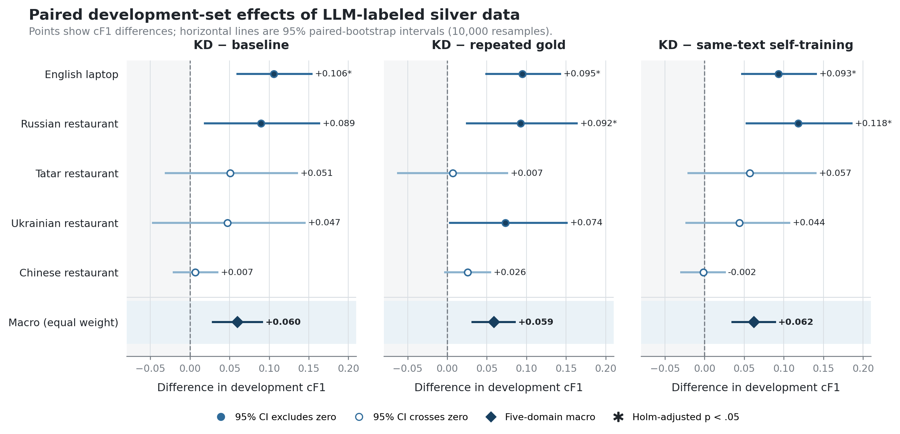

# When Does LLM-Labeled Silver Data Help?

## An Inductive-Safe Study of Offline Structured Distillation for Multilingual Dimensional Aspect Sentiment Quad Prediction

**Draft status:** Sections 3--8, working manuscript, 2026-08-15.

> Editorial note: this Markdown file is the editable source draft and is not the
> ICONIP manuscript. Bracketed `[CITE: ...]` markers are unresolved bibliography
> tasks, not submission-ready citations. Numerical results must be imported from
> `docs/audits/tallip_kd/tallip_core_tables.md` after its verification command
> passes.

## 3 Task and Offline Structured Distillation

### 3.1 Dimensional Aspect Sentiment Quad Prediction

Given an input sentence (x=(x_1,\ldots,x_n)), the Dimensional Aspect
Sentiment Quad Prediction (DimASQP) task requires a system to predict an
unordered set

\[
Y=\{(a_i,c_i,o_i,V_i,A_i)\}_{i=1}^{m},
\]

where (a_i) is an aspect span or `NULL`, (o_i) is an opinion span or
`NULL`, and (c_i) is an entity--attribute category defined by the dataset.
The two continuous labels (V_i,A_i\in[1,9]) represent valence and arousal,
respectively. A sentence can contain no opinion, one opinion, or multiple
opinions; the cardinality (m) is therefore unknown at prediction time.
[CITE: DimABSA/SemEval-2026 task overview]

We use the official Task-3 continuous F1 (cF1) as the primary metric. A
predicted quad is eligible for matching when its categorical triple
((a,c,o)) matches a gold triple. For each matched pair, the continuous true
positive credit is

\[
\operatorname{cTP}
=1-\frac{\sqrt{(V_p-V_g)^2+(A_p-A_g)^2}}{\sqrt{2(9-1)^2}}.
\]

Continuous precision and recall replace the ordinary true-positive count with
the sum of this credit, and cF1 is their harmonic mean. The metric consequently
penalizes both structural extraction errors and inaccurate valence--arousal
estimates. We compute all primary scores with the official evaluator. For
teacher diagnosis, we additionally report exact categorical F1; aspect,
opinion, and category F1; valence--arousal mean absolute error and root mean
squared error on matched quads; and coverage for `NULL`, rare categories,
empty outputs, and invalid outputs.

### 3.2 Fixed Student Model

Our experiments build on the LEADER-DimASQP student introduced in our earlier
ICONIP study [CITE: ICONIP-V20]. We treat that model and its dataset-specific
training recipes as inherited experimental infrastructure rather than as a new
contribution of the present work. Fixing the student is essential here: the
object of study is the supervision supplied by LLM-labeled silver data, not a
new extraction architecture.

In brief, the student encodes the sentence and predicts aspect and opinion BIO
spans. It forms candidate aspect--opinion pairs and uses task-specific heads to
predict pair validity, entity and attribute labels, and continuous valence and
arousal. A lightweight Rethink stage embeds the draft span, category, and
valence--arousal predictions and fuses them back into the token
representations. Candidate quads are aligned with gold quads through Hungarian
set matching. The inherited training recipes also use mild fast-gradient
adversarial perturbations and an exponential moving average. At inference,
five independently trained students vote on the categorical triple; retained
quads carry the corresponding continuous predictions.

We preserve the encoder and optimization recipe selected for each dataset in
the prior study. The five adopted distillation settings use DeBERTa-v3-base for
English laptop, XLM-R-large for Russian and Tatar restaurant, mDeBERTa-v3-base
for Ukrainian restaurant, and Chinese RoBERTa-wwm-ext-large for Chinese
restaurant. No architecture component, encoder, or inference rule is selected
using the experiments reported in this paper.

### 3.3 Offline Structured Label Distillation

Let (G_d) denote the labeled training data for dataset (d), and let (U_d)
be an unlabeled text pool from the same task domain. An LLM teacher (t)
maps each (u\in U_d) to a set of structured DimASQP labels. The prompt
requires non-`NULL` aspects and opinions to be verbatim substrings of the
input, restricts categories to the inventory derived from (G_d), constrains
valence and arousal to ([1,9]), and permits an empty set when the sentence
contains no in-domain opinion. Responses are parsed into the task JSON schema,
and accepted examples form the silver set (S_{d,t}). The student is then
trained on

\[
T_{d,t}=G_d\cup S_{d,t}.
\]

This is response-based structured distillation: the teacher supplies hard
structured labels rather than logits, hidden states, or token-level
probabilities. The LLM is used only while constructing (S_{d,t}). Validation,
official-test evaluation, and deployment use the student checkpoints alone and
make no teacher calls.

The adopted systems cover five datasets and were fixed before official-test
labels were inspected. Table 1 records the supervision actually used after the
inductive audit. The “gold/base” column includes the inherited non-silver
training recipe, which can contain training-only augmentation from the prior
system; it is therefore not always equal to the raw gold-train size.

**Table 1. Adopted offline-distillation settings after inductive cleaning.**

| Dataset | Fixed encoder | LLM teacher | Silver pool | Gold/base rows | Silver rows | Total rows | Vote |
|---|---|---|---|---:|---:|---:|---:|
| English laptop | DeBERTa-v3-base | DeepSeek V4 Pro | existing in-domain pool | 15,048 | 7,547 | 22,595 | 4 |
| Russian restaurant | XLM-R-large | DeepSeek V4 Pro | native generation, gen4k batch | 1,240 | 3,000 | 4,240 | 3 |
| Tatar restaurant | XLM-R-large | Qwen3.6-35B | native generation | 1,240 | 3,915 | 5,155 | 3 |
| Ukrainian restaurant | mDeBERTa-v3-base | DeepSeek V4 Pro | translated construction | 2,966 | 5,534 | 8,500 | 3 |
| Chinese restaurant | Chinese RoBERTa-wwm-ext-large | DeepSeek V4 Pro | real-text pool | 6,050 | 3,882 | 9,932 | 3 |

The choices in Table 1 are not claims of a universally optimal teacher or pool.
They are the frozen adopted systems whose behavior we audit. Separate matched
experiments vary teacher identity, pool source, or silver quantity while
holding the remaining observable factors fixed when the available data permit
such a comparison.

### 3.4 Experimental Factors and Competing Explanations

We distinguish four factors that are often conflated in silver-data studies.
First, **teacher fidelity** measures whether an LLM can directly reproduce
hidden gold labels. Second, **pool source** describes where the unlabeled text
comes from: native generation, real public text, or machine translation.
Third, **silver quantity** is the number of accepted silver rows. A comparison
between independently generated batches changes both quantity and batch
composition, whereas a cap applied to one fixed pool changes quantity while
preserving the underlying source. Fourth, **information complementarity**
describes whether silver supervision supplies valid categories, spans, or
error corrections that are underrepresented in the base training data.

A higher downstream score alone cannot identify which factor is responsible.
It may also reflect more optimizer updates, a favorable random seed, train--test
text overlap, or labels that the student could have produced itself. We
therefore combine direct teacher evaluation with inductive cleaning,
five-seed training, exposure-matched repeated-gold controls, same-text student
self-training controls, and paired inference on frozen predictions.

## 4 Experimental Design

### 4.1 Datasets and Evaluation Roles

We study all eight datasets from SemEval-2026 Task 3 [CITE: DimABSA/SemEval-2026
task overview]. They span English, Japanese, Russian, Tatar, Ukrainian, and
Chinese, with laptop, restaurant, and hotel domains. Table 2 reports the raw
gold split sizes. All eight datasets participate in direct teacher-fidelity
evaluation. Five datasets---English laptop and the Russian, Tatar, Ukrainian,
and Chinese restaurant sets---have a frozen adopted KD system and enter the
matched downstream analyses. English restaurant, Japanese hotel, and Chinese
laptop retain their inherited non-KD main systems and are not silently counted
as KD successes.

**Table 2. Gold data and evaluation roles.**

| Dataset | Language | Domain | Train | Dev | Test | Direct fidelity | Adopted KD |
|---|---|---|---:|---:|---:|---|---|
| eng_laptop | English | laptop | 4,076 | 200 | 1,000 | yes | yes |
| eng_restaurant | English | restaurant | 2,284 | 200 | 1,000 | yes | no |
| jpn_hotel | Japanese | hotel | 1,600 | 200 | 800 | yes | no |
| rus_restaurant | Russian | restaurant | 1,240 | 48 | 630 | yes | yes |
| tat_restaurant | Tatar | restaurant | 1,240 | 48 | 630 | yes | yes |
| ukr_restaurant | Ukrainian | restaurant | 1,240 | 48 | 630 | yes | yes |
| zho_laptop | Chinese | laptop | 3,490 | 300 | 1,000 | yes | no |
| zho_restaurant | Chinese | restaurant | 6,050 | 300 | 1,000 | yes | yes |

The development sets serve two distinct roles. Their labels are hidden from the
LLMs when directly measuring teacher fidelity, while the student experiments
use development cF1 for the inherited validation-based checkpoint rule. The
released official test labels are reserved for a single post-competition local
evaluation after systems, thresholds, prediction files, and hashes have been
locked.

### 4.2 Contamination Audit and Inductive Cleaning

We audit the gold, pool, silver, combined distillation, development, and test
files registered for all eight datasets. Each training-side row is checked
against development and test by exact text, normalized text, and source ID.
The normalization key applies Unicode NFKC normalization, Unicode case folding,
and Unicode-whitespace collapse. The audit stores the source path, source
SHA-256, line number, matched split, match reason, and normalized text for each
detected row.

Three adopted KD inputs contain development- or test-overlapping text and are
filtered without reordering the retained rows. English laptop changes from
23,590 to 22,595 rows, Ukrainian restaurant from 9,105 to 8,500, and Chinese
restaurant from 10,911 to 9,932. The corresponding English and Ukrainian
baseline inputs each contain one normalized development overlap and are also
cleaned, from 15,049 to 15,048 rows and from 2,967 to 2,966 rows, respectively.
The Russian gen4k and Tatar Qwen adopted inputs have zero normalized overlap and
are retained unchanged. We then verify that every final adopted KD input and
every baseline input used for a clean paired comparison has zero normalized
text overlap with development and test. Original checkpoints are preserved;
clean runs use distinct prefixes.

This cleaning step defines the inductive protocol and is not conditioned on
whether removal raises or lowers cF1. We report comparisons with the earlier
transductive checkpoints only to quantify sensitivity, never as evidence that
overlap would have been acceptable.

### 4.3 Direct Teacher-Fidelity Evaluation

We evaluate DeepSeek V4 Pro and Qwen3.6-35B directly on every gold development
set. We remove the complete `Quadruplet` field before sending an example to a
teacher. The category inventory and six few-shot demonstrations are drawn only
from that dataset's training split. Both teachers receive prompt version
`dim-asqp-fidelity-v1`, temperature 0.3, and disabled reasoning output. A
10-example smoke run checks model identity, schema compatibility, and output
coverage before a full run is accepted.

Across the eight datasets, the development sets contain 1,344 examples. Each
teacher produces exactly one validated record for every example, giving 1,344
DeepSeek and 1,344 Qwen annotations with zero final error rows. We retain the
label-free inputs, raw responses, parsed outputs, requested and returned model
names, prompt version, temperature, timestamps, and SHA-256 hashes. The main
fidelity metric is official cF1. The auxiliary metrics defined in Section 3.1
diagnose whether a difference comes from structure, category, continuous
sentiment, empty output, or an infrequent training category. A category is
treated as rare for this diagnostic when it appears no more than five times in
the corresponding training split.

Direct fidelity does not by itself establish which teacher produces the best
training signal. To test whether a downstream teacher ranking can be reproduced
under matched conditions, we additionally train Tatar students on the same
1,240 gold rows and the same 3,915 silver texts in the same order, changing only
whether DeepSeek or Qwen supplies the silver labels. Both arms use all five
seeds and the same frozen inference threshold.

### 4.4 Student Training and Frozen Inference

Every five-seed experiment uses random seeds 42, 123, 456, 789, and 1024. We
inherit the dataset-specific model configuration, optimizer, training data
order, augmentation recipe, maximum of 30 epochs, validation-based checkpoint
selection, and early-stopping patience of eight from the corresponding fixed
student. The adopted configurations use AdamW, an encoder learning rate of
(1.5\times10^{-5}), a warmup ratio of 0.1, weight decay 0.01, gradient-norm
clipping at 1.0, FGM with \(\epsilon=0.1\), and EMA with decay 0.999. Batch size
is eight for the base-size English and Ukrainian encoders and four for the large
Russian, Tatar, and Chinese encoders. We retain and evaluate
`checkpoint_best.pt`; no last-epoch checkpoint is substituted.

For the clean-inductive reruns, the only intended experimental change is the
removal of overlapping rows. The five-seed ensemble thresholds are fixed at
vote 4 and top-k 0 for English laptop, and vote 3 and top-k 0 for Russian,
Tatar, Ukrainian, and Chinese restaurant. The matched baseline can retain its
own previously fixed threshold; thresholds are not re-swept to favor a
contrast. We report every single-seed cF1, the mean and sample standard
deviation across seeds, and the frozen ensemble cF1.

### 4.5 Controls for Exposure and Teacher Source

The **repeated-gold control** tests whether a gain can be explained by seeing
more training rows or performing more updates. For each adopted KD dataset, we
repeat the inductive-safe base training rows as evenly as possible until the
control has exactly the same number of rows as the corresponding gold-plus-LLM
training input. Complete copies preserve source order; a remainder is selected
after a deterministic shuffle with seed 20260713. Duplicate copies receive
unique IDs. Each constructed file must have zero normalized overlap with
development and test, and it is trained with the same student recipe and five
seeds as the adopted KD arm.

The **same-text self-training control** tests the value of LLM labels rather
than the value of the unlabeled text itself. We extract exactly the silver-text
tail used by an adopted LLM arm, preserve its IDs and order, and remove its
labels. A five-seed ensemble trained on the repeated-gold control then labels
those texts. We combine the inductive-safe base rows with the resulting student
pseudo-labels, retaining empty predictions as valid no-quad pseudo-labels. The
final self-training input therefore has the same base rows, the same silver
texts, the same silver row count, and the same total row count as the LLM arm;
the supervision source on the silver texts is the intended difference. It is
trained with the same five seeds and evaluated using the adopted system's
frozen threshold.

All exposure and self-training controls were registered after the official-test
systems had been locked. They use development data only, and their manifests
explicitly forbid official-test evaluation. Consequently, they refine the
mechanistic interpretation of the development results but cannot retrospectively
alter any main-system or test choice.

### 4.6 Teacher, Pool, and Quantity Ablations

We organize auxiliary ablations by the strength of their control. The direct
8-by-2 fidelity experiment compares teachers on identical label-hidden inputs.
The Tatar downstream experiment compares teachers on identical gold and silver
texts. For Russian pool source, real, translated, and generated text is labeled
by the same teacher and capped at 3,000 rows. The Chinese real-versus-generated
comparison is retained as observational evidence because other construction
details are not fully matched.

Quantity is evaluated separately from pool identity. In Russian, we take the
same gen8k silver pool and compare a cap of 3,000 with all 7,988 rows for paired
seeds 42 and 123. A preregistered gate required the two-seed mean to improve by
at least 1.5 percentage points before training the remaining seeds or adding a
5,000-row arm. The gate failed, so the remaining quantity curve was not run.
This stopping rule can test whether the earlier gen4k advantage is explained by
having fewer rows; it cannot identify a universal optimal silver dose.

### 4.7 Paired Inference, Macro Effects, and Multiplicity

For a comparison between systems (A) and (B), we resample evaluation
examples with replacement, recompute both cF1 scores from the corresponding
row-level sufficient statistics, and record \(\Delta=\operatorname{cF1}_A-
\operatorname{cF1}_B\). Every paired bootstrap uses 10,000 resamples and random
seed 20260713. We report the observed delta, percentile 95% confidence interval,
and two-sided bootstrap p-value. An interval whose lower bound is above zero is
classified as supported improvement; an interval that crosses zero is
inconclusive; and an interval whose upper bound is below zero supports harm.
An inconclusive interval is not interpreted as equivalence.

To summarize the five adopted datasets without allowing the larger English or
Chinese evaluation sets to dominate, we also use a fixed-task macro bootstrap.
Examples are resampled independently within each dataset, a paired delta is
recomputed, and the five dataset deltas receive equal weight. This estimand is
the macro-average effect over the fixed adopted-domain set, not an estimate for
unobserved languages or tasks.

We treat teacher fidelity, adopted KD versus baseline, exposure control,
same-text self-training, self-training versus repeated gold, and frozen
official-test comparisons as separate families. Within each family, we report
both Holm family-wise-error correction and Benjamini--Hochberg false-discovery
correction. The official-test correction is a post-hoc robustness analysis and
does not change the previously frozen systems. Dataset-level confidence
intervals remain visible so that aggregate support cannot be misread as support
for every domain.

### 4.8 Official-Test Lock and Reproducibility

The official-test evaluation is a one-shot, post-competition local analysis of
the released Task-3 labels. Before obtaining those labels, we fixed each main
system, comparison baseline, five-seed checkpoint set, vote and top-k threshold,
test input, prediction file, row count, and SHA-256 hash in a protocol manifest.
All selections were based on development evidence. Test labels were not used to
choose a checkpoint, teacher, pool, augmentation recipe, threshold, or stopping
rule. We therefore describe these scores as a frozen local evaluation, not as a
new shared-task submission.

The reproducibility package retains the contamination matches and deletion
records, clean-file hashes, teacher inputs and raw responses, validated outputs,
training and inference manifests, seed-level predictions, best-checkpoint
provenance, bootstrap seed, and exact-repeat audit. Automated checks verify that
teacher inputs contain no `Quadruplet`, each input ID has one output or an
explicit error record, final adopted training inputs have zero normalized
development/test overlap, inference uses `checkpoint_best.pt`, frozen ensemble
thresholds are respected, and the six core evidence tables match their locked
hashes.

Post-lock control training was run on a single 24-GB NVIDIA RTX 4090. LLMs are
offline annotators only, so student inference makes zero LLM calls. Historical
provider token counts and monetary billing were not retained; we report them as
unavailable rather than reconstructing a potentially misleading cost estimate.

## 5 Results

### 5.1 Direct Fidelity Favors DeepSeek Overall, but Most Pairwise Differences Remain Uncertain

Table 3 reports teacher fidelity when the complete development labels are
hidden. DeepSeek obtains the higher cF1 point estimate on all eight datasets,
but the size and certainty of the difference vary substantially. The paired
95% interval excludes zero for English restaurant, Chinese laptop, and Chinese
restaurant only; these same three comparisons remain significant after Holm
and Benjamini--Hochberg correction within the eight-dataset family. The other
five comparisons are inconclusive rather than evidence of equivalence.

**Table 3. Direct teacher fidelity on label-hidden gold development data.**

| Dataset | DeepSeek cF1 | Qwen cF1 | DeepSeek−Qwen | 95% CI | Decision |
|---|---:|---:|---:|---:|---|
| eng_laptop | 0.3575 | 0.3170 | +0.0404 | [−0.0066, +0.0879] | inconclusive |
| eng_restaurant | 0.5529 | 0.3638 | +0.1892 | [+0.1418, +0.2384] | supported |
| jpn_hotel | 0.2146 | 0.2004 | +0.0142 | [−0.0344, +0.0610] | inconclusive |
| rus_restaurant | 0.3904 | 0.3649 | +0.0255 | [−0.0494, +0.1039] | inconclusive |
| tat_restaurant | 0.4359 | 0.3954 | +0.0405 | [−0.0675, +0.1516] | inconclusive |
| ukr_restaurant | 0.3786 | 0.3598 | +0.0188 | [−0.0579, +0.0879] | inconclusive |
| zho_laptop | 0.2821 | 0.2374 | +0.0447 | [+0.0137, +0.0755] | supported |
| zho_restaurant | 0.4653 | 0.4060 | +0.0593 | [+0.0240, +0.0941] | supported |

Direct fidelity and downstream student performance need not induce the same
ranking. On the Tatar matched-text control, the DeepSeek-labeled arm reaches
0.5365 ensemble cF1 and the Qwen-labeled arm reaches 0.5327. Their difference
is only +0.0038 with a 95% CI of [−0.0823,+0.0852]. On the frozen official test,
the matched DeepSeek−Qwen difference is likewise positive but inconclusive at
+0.0109 [−0.0069,+0.0293]. Thus, the earlier observation that one Qwen student
scored higher under a different run does not establish a reliable Tatar
teacher-ranking reversal.

### 5.2 Clean-Inductive KD Has a Positive Macro Effect and Heterogeneous Domain Effects

All five adopted systems remain operational after the inductive audit. Table 4
shows the five individual seed scores, their mean and sample standard deviation,
the frozen ensemble, and the paired ensemble contrast with its matched baseline.
English and Russian show supported development improvements. Tatar, Ukrainian,
and Chinese restaurant have positive point estimates but intervals that cross
zero. After Holm correction within the five-domain baseline family, only the
English comparison remains significant; English and Russian remain significant
under Benjamini--Hochberg correction.

**Table 4. Clean-inductive KD results and paired development contrasts.**

| Dataset | Five seed cF1 scores | Mean±SD | Ensemble | KD−baseline | 95% CI | Decision |
|---|---|---:|---:|---:|---:|---|
| eng_laptop | .3826/.3610/.3900/.3799/.3789 | 0.3785±0.0107 | 0.4102 | +0.1058 | [+0.0601,+0.1537] | supported |
| rus_restaurant | .5714/.5471/.5487/.5578/.5513 | 0.5553±0.0099 | 0.6162 | +0.0895 | [+0.0191,+0.1631] | supported |
| tat_restaurant | .4798/.4538/.4681/.4733/.4437 | 0.4637±0.0147 | 0.5327 | +0.0506 | [−0.0302,+0.1353] | inconclusive |
| ukr_restaurant | .4448/.4835/.4601/.5016/.5353 | 0.4851±0.0355 | 0.5377 | +0.0472 | [−0.0466,+0.1449] | inconclusive |
| zho_restaurant | .5391/.5417/.5427/.5405/.5361 | 0.5400±0.0026 | 0.5738 | +0.0069 | [−0.0204,+0.0349] | inconclusive |

The fixed-task macro analysis gives each adopted dataset equal weight. It
estimates KD−baseline at +0.0600 cF1 with a 95% CI of
[+0.0291,+0.0911]. This supports a positive average effect over the fixed
five-domain set, but it does not convert the three inconclusive dataset-level
results into supported individual effects or justify extrapolation to unseen
languages.

Cleaning does not produce a reliable change relative to the earlier
transductive checkpoints: clean−transductive is −0.0038
[−0.0444,+0.0351] for English, −0.0183 [−0.0738,+0.0292] for Ukrainian,
and +0.0159 [−0.0075,+0.0398] for Chinese restaurant. This sensitivity result
does not make the original overlap acceptable. It instead shows that the main
directional findings can be stated using inputs that satisfy the inductive
protocol.

### 5.3 Matched Controls Reject a Pure Exposure Explanation on Average

Figure 1 places the three principal development contrasts on one common cF1
scale. The macro effect remains supported when the baseline is replaced by
either repeated gold or same-text student self-training. However, the
dataset-level intervals reveal that the evidence is concentrated rather than
uniform.

**Figure 1.** Development-set cF1 differences with 95% paired-bootstrap
intervals. Each panel uses the same five adopted datasets. The diamond is the
equal-dataset-weight macro estimate; filled circles indicate an unadjusted
interval that excludes zero, open circles are inconclusive, and a star marks a
dataset comparison that remains significant after Holm correction within its
five-comparison family.

Table 5 summarizes the aggregate estimates and the number of dataset-level
comparisons supported before and after multiplicity correction. KD exceeds the
exposure-matched repeated-gold control by +0.0588
[+0.0318,+0.0853] on average and the same-text self-training control by +0.0621
[+0.0351,+0.0888]. By contrast, self-training−repeated-gold is −0.0033
[−0.0226,+0.0170], so the two non-LLM controls have no reliable macro ordering.

**Table 5. Fixed-task macro effects and dataset-level multiplicity summary.**

| Contrast | Macro ΔcF1 | 95% CI | Raw supported domains | Holm-supported domains |
|---|---:|---:|---|---|
| KD−baseline | +0.0600 | [+0.0291,+0.0911] | eng, rus | eng |
| KD−repeated gold | +0.0588 | [+0.0318,+0.0853] | eng, rus, ukr | eng, rus |
| KD−same-text self-training | +0.0621 | [+0.0351,+0.0888] | eng, rus | eng, rus |
| Self-training−repeated gold | −0.0033 | [−0.0226,+0.0170] | zho | zho |

The domain-level controls narrow the mechanism claim. For English and Russian,
LLM KD reliably exceeds both repeated-gold exposure and student labels on the
same texts, and these differences survive Holm correction. Ukrainian KD exceeds
repeated gold in the unadjusted comparison (+0.0736
[+0.0036,+0.1507]) but not after family-wise correction, and its advantage over
same-text self-training is inconclusive. Neither Tatar nor Chinese restaurant
establishes a reliable LLM-label advantage. Chinese self-training itself
exceeds repeated gold by +0.0276 [+0.0079,+0.0463], which shows why an exposure
control alone is insufficient for attributing a gain to an LLM teacher.

### 5.4 Teacher, Pool, and Quantity Do Not Admit a Universal Ranking

Table 6 summarizes the most controlled ablations and the boundary of each
inference. The direct teacher matrix supports greater overall consistency for
DeepSeek, but the matched Tatar downstream arm does not support a universal
teacher ordering. The Russian pool experiment provides a clear within-domain
ordering under a common teacher and cap, while the Chinese observation points
in a different direction under a weaker control. Together, these results reject
a universal pool-source ranking rather than establishing that either generated
or real text is generally superior.

**Table 6. Controlled ablations and allowed interpretation.**

| Axis | Controlled comparison | Result | Allowed interpretation |
|---|---|---|---|
| Teacher fidelity | 8 datasets × identical label-hidden dev inputs | DeepSeek higher in 8/8; supported in 3/8 | DeepSeek is more consistent overall; no universal pairwise dominance claim |
| Teacher downstream | Tatar, same gold and 3,915 silver texts, five seeds | DeepSeek−Qwen +0.0038 [−0.0823,+0.0852] | no reliable downstream ranking difference |
| Pool source | Russian, same DeepSeek teacher and cap=3,000 | generated .6162 > translated .5761 > real .5586 | strong within-Russian ordering only |
| Pool source | Chinese restaurant, real vs generated | real−generated +0.023 cF1 | observational; other factors are not fully matched |
| Silver quantity | Russian, same gen8k pool, seeds 42/123 | cap3000−full7988 = −0.0114 mean | lower quantity does not explain the independent gen4k advantage |
| Translation/native | Ukrainian pools differ in construction and quantity | mixed | descriptive evidence only |

The Russian same-pool quantity result failed the preregistered +1.5 percentage
point continuation gate. We therefore did not train the other three seeds or a
cap5000 arm. The independent gen4k batch can outperform the gen8k batch, but its
advantage is more consistent with batch composition, coverage, or labeling
quality than with a general preference for fewer silver rows. The evidence does
not identify a dose--response curve or an optimal cap.

### 5.5 Complementarity Measurements Are Informative but Not a Causal Moderator

The direct measurements in Table 7 provide counterexamples to a single-metric
explanation. English laptop has the largest observed span-coverage expansion
and the largest development gain. Chinese restaurant has the highest direct
DeepSeek fidelity in Table 3, yet it has the smallest development gain and loses
aspect and opinion span coverage relative to its base data. Russian and Tatar
show positive downstream point estimates without a consistent increase in both
span inventories.

**Table 7. Descriptive complementarity and row-level error transitions.**

| Dataset | Silver rows | Aspect/opinion span coverage Δ | Category JSD Δ | Repaired/harmed dev rows | KD−baseline cF1 |
|---|---:|---:|---:|---:|---:|
| eng_laptop | 7,547 | +21/+38 | −0.0141 | 71/44 | +0.1058 |
| rus_restaurant | 3,000 | −4/+0 | +0.0503 | 20/19 | +0.0895 |
| tat_restaurant | 3,915 | −9/+4 | +0.0571 | 16/20 | +0.0506 |
| ukr_restaurant | 5,534 | +4/+9 | +0.0241 | 22/18 | +0.0472 |
| zho_restaurant | 3,882 | −30/−56 | −0.0009 | 130/112 | +0.0069 |

Across only five domains, teacher fidelity versus KD gain has Spearman
\(\rho=-0.70\) with a bootstrap interval of [−1.00,+0.875], span-coverage gain
versus KD gain has \(\rho=+0.70\) [−0.875,+1.00], and category-alignment gain
has \(\rho=+0.10\) [−1.00,+1.00]. The intervals are too wide to establish a
moderator. Slices by sentence length, single versus multiple quads, rare
category, and implicit aspect or opinion are also heterogeneous. These
measurements support a multi-factor interpretation involving validity,
coverage, distribution, and teacher--student fit; they do not prove
“information complementarity” as a universal causal law.

### 5.6 Frozen Official-Test Evaluation Supports Conditional Generalization

Table 8 reports the one-shot post-competition evaluation. Among the five
preregistered KD contrasts, English, Russian, Tatar, and Ukrainian have raw
paired intervals above zero. Chinese restaurant has a negative point estimate
and an interval crossing zero. After Holm correction within this five-contrast
family, English, Tatar, and Ukrainian remain significant; Russian does not.

**Table 8. Frozen main systems on official test and preregistered KD contrasts.**

| Dataset | Frozen main system | Test cF1 | KD−baseline | 95% CI | Holm < .05 |
|---|---|---:|---:|---:|---|
| eng_laptop | clean DeepSeek KD | 0.3532 | +0.0822 | [+0.0629,+0.1021] | yes |
| eng_restaurant | inherited V16 baseline | 0.5904 | — | — | — |
| jpn_hotel | inherited V16 no-augmentation | 0.4217 | — | — | — |
| rus_restaurant | DeepSeek gen4k KD | 0.5189 | +0.0211 | [+0.0005,+0.0431] | no |
| tat_restaurant | Qwen KD | 0.4311 | +0.0274 | [+0.0071,+0.0482] | yes |
| ukr_restaurant | clean DeepSeek KD | 0.4608 | +0.0393 | [+0.0150,+0.0639] | yes |
| zho_laptop | inherited V16 baseline | 0.4309 | — | — | — |
| zho_restaurant | clean DeepSeek real-pool KD | 0.4660 | −0.0137 | [−0.0289,+0.0014] | no |

The test results strengthen the conclusion that KD can help under selected
domain conditions, but they do not support a five-domain success claim. They
also do not constitute a test-set model-selection loop: all choices and
prediction hashes were frozen before the labels were retrieved, and no
post-lock control was evaluated on official test. None of the eight main
systems exceeds the corresponding official leaderboard best, so we make no
test SOTA claim.

## 6 Discussion

### 6.1 Reliable Average Benefits Can Coexist with Domain-Level Uncertainty

The central empirical pattern is not that KD either works or fails everywhere.
Across the fixed five-domain set, KD has a positive macro effect relative to the
matched baseline, repeated-gold exposure, and same-text student self-training.
At the same time, the dataset-level intervals differ markedly. English and
Russian provide the strongest development evidence that the LLM labels add
information beyond both non-LLM controls. Ukrainian provides weaker evidence:
its exposure-adjusted comparison is positive before, but not after, family-wise
correction, and its same-text teacher-source comparison remains inconclusive.
Tatar and Chinese restaurant do not establish a reliable LLM-label advantage
on development data.

These statements answer different questions. The macro bootstrap asks whether
the mean paired effect over the prespecified adopted-domain set is positive when
each dataset receives equal weight. A dataset-level interval asks whether one
domain independently supports the contrast. A supported macro effect therefore
does not imply five supported domain effects, just as an inconclusive
small-domain interval does not prove that its true effect is zero. This
distinction is especially important for Russian, Tatar, and Ukrainian, whose
development sets contain only 48 examples and consequently yield wide
intervals.

The one-shot official-test results are consistent with conditional rather than
universal generalization. Four of five raw KD contrasts are positive with
intervals above zero, while three remain significant after Holm correction.
Chinese restaurant is an important counterexample: its development ensemble has
a small positive contrast, whereas its test contrast is slightly negative and
inconclusive. We therefore interpret the aggregate result as evidence that
offline LLM supervision can be useful over the studied set, not as a guarantee
for every language, domain, or split.

Nor does the pattern support a simple low-resource rule. English laptop has the
largest development gain despite having more raw gold training examples than
the three 1,240-row Slavic/Turkic restaurant sets, while the larger Chinese
restaurant set shows the weakest adopted-KD contrast. Gold size alone is not a
sufficient predictor of benefit.

### 6.2 Direct Fidelity Is a Screening Signal, Not a Sufficient Selection Rule

Directly evaluating a teacher on label-hidden gold data removes a major
ambiguity in downstream-only studies. It reveals whether the teacher can
produce valid task structures and provides paired teacher comparisons before
student optimization is considered. The 8-by-2 experiment indicates that
DeepSeek is more consistent overall, but five of the eight pairwise differences
remain uncertain. The matched Tatar experiment further shows that small
downstream fluctuations cannot be used to infer a reliable reversal in teacher
quality.

Fidelity alone is nevertheless insufficient for selecting a complete KD
pipeline. Chinese restaurant illustrates the limitation most clearly: it has
the highest direct DeepSeek fidelity among the adopted domains, but the smallest
development gain and no supported official-test benefit. Direct fidelity is
measured on the gold development distribution, whereas downstream training
also depends on which texts enter the silver pool, which categories and spans
they cover, how their label distribution interacts with the base data, and how
the student responds to the resulting mixture. A teacher can therefore label
gold-like examples accurately without supplying useful new supervision, or it
can add useful coverage even when its aggregate fidelity is not the highest.

The pool and quantity experiments reinforce this view. Under a common Russian
teacher and cap, generated, translated, and real pools have a clear domain-local
ordering. The observational Chinese comparison points in the opposite
direction, and the Russian same-pool cap intervention shows that reducing the
gen8k batch does not recover the separate gen4k result. These findings favor a
multi-factor account involving label validity, pool composition, coverage, and
teacher--student fit. “Information complementarity” is a useful description of
that account, but our measured proxies are not monotonic and were not
independently manipulated. It should not be treated as a proven universal
moderator.

### 6.3 An Audit-First Workflow Is More Defensible Than a Larger KD Grid

The experiments suggest a practical workflow for multilingual and low-resource
structured prediction. First, a small label-hidden gold probe should be used to
measure candidate teachers directly, including invalid, empty, `NULL`, rare
category, span, and continuous-label behavior. Second, every gold, augmented,
pool, silver, and combined training file should be audited against development
and test using a documented normalization key. Cleaning should be decided by
the inductive protocol, not by whether deletion improves the score.

Third, teacher, pool, and quantity decisions should be made within the target
domain under frozen development rules. A ranking learned on Russian restaurant
data should not be transferred to Chinese restaurant without a matched test.
Fourth, multiple training seeds and paired example-level inference should be
reported because seed variation and evaluation-example variation answer
different uncertainty questions. Fifth, an exposure-matched control should be
the minimum comparison when silver data increases the number of training rows.
Where feasible, the stronger comparison is same-text self-training, which holds
the unlabeled text fixed and changes the supervision source. Finally, test data
should be used once, after checkpoint, threshold, and prediction hashes are
locked.

This workflow also provides a principled stopping rule. Once direct fidelity,
clean-inductive reruns, matched non-LLM controls, and frozen evaluation agree on
the boundary of the claim, adding more teacher, pool, augmentation, or cap arms
can increase multiplicity without resolving the main uncertainty. The failed
Russian quantity gate is an example: stopping after the preregistered criterion
failed is more informative than completing a post-hoc curve and selecting its
best point.

### 6.4 Offline Distillation Moves LLM Cost Out of Deployment but Does Not Make Training Free

The deployed system contains five student checkpoints and makes no LLM calls.
This separates annotation-time access to a large teacher from inference-time
operation and can be attractive when an API-based or 35B-parameter teacher is
too costly or unavailable in production. In retained development logs for the
gold-repeat controls using the same student configurations, the five-model
ensembles process between 10.77 and 26.46 output rows per second in the CUDA
model-forward loop, depending on the dataset and inherited encoder. These rates
exclude checkpoint loading, tokenization setup, voting, and output serialization
and should not be interpreted as end-to-end KD latency benchmarks.

The evidence closure itself is computationally substantial. The 50 retained
best checkpoints from the repeated-gold and self-training controls occupy
301.54 GiB, and their recorded training logs sum to 134.98 run-wall hours on one
RTX 4090, including checkpoint I/O. These measurements document the cost of the
study rather than a controlled comparison between encoders, configurations, or
storage devices. Historical token-usage and provider-billing fields were not
retained, so we cannot reconstruct a defensible monetary cost for all silver
generation. Future experiments should store tokens, wall time, retries, model
revision, and billing metadata at collection time.

### 6.5 Relation to Our Prior ICONIP Study

Our ICONIP V20 work introduced LEADER-DimASQP, language- and dataset-specific
encoder/recipe selection, and five-seed inference [CITE: ICONIP-V20]. The
present study reuses those components to hold student capacity and decoding
policy as stable as possible. It does not claim Rethink, Hungarian matching,
language-specific encoders, or ensembling as new contributions.

The new research question is when LLM-labeled silver data improves that fixed
student and how such a claim can be audited. The evidence added here---direct
two-teacher fidelity across eight datasets, matched teacher/pool/quantity
comparisons, clean-inductive reruns, exposure and same-text controls,
multiplicity-aware paired inference, and a dev-locked official-test
evaluation---was not part of V20. This distinction is methodological as well as
editorial: architecture improvements and silver-supervision effects are not
pooled into one attribution claim.

## 7 Limitations and Ethical Considerations

### 7.1 Scope and Statistical Power

The study covers one structured sentiment task, six languages, eight datasets,
and three review domains. Direct fidelity uses all eight datasets, but the
downstream macro and control analyses are restricted to five previously adopted
KD systems. Those systems were selected through earlier development work, so
the macro estimand describes this fixed adopted set rather than a random sample
of languages or all eight task datasets. In particular, the three non-adopted
datasets do not have comparable downstream KD controls and cannot be counted as
negative or positive KD evidence.

Several low-resource development sets contain only 48 examples. Paired
resampling preserves the available example-level uncertainty but cannot create
information that is absent from a small evaluation set. The exploratory
moderator analysis has only five domain-level observations; its wide intervals
preclude a reliable correlation claim. Larger multilingual benchmarks and
prospectively selected domains are needed to test whether the present macro
effect generalizes.

The official-test analysis is intentionally one-shot. Its family-wise
correction is a post-hoc robustness check, not a new selection criterion, and
the test results were not replicated across alternative task collections.
Although the lock prevents test-guided model selection in this study, a future
paper that chooses hypotheses based on these released labels would require a
new held-out evaluation source.

### 7.2 Limits of Causal Attribution

The repeated-gold control matches total row exposure, and the self-training
control additionally matches silver text and row count. These comparisons
remove important alternative explanations, but they do not randomize every
property of the training process. Student pseudo-labels are produced by the
repeated-gold ensemble, and differences in label density, empty predictions,
confidence, and error structure remain part of the teacher-source treatment.
The controls therefore support statements about the complete supervision
source, not a claim that one isolated linguistic feature causes the gain.

Only the Russian pool comparison and Tatar teacher comparison closely match the
principal observable factors. The Chinese pool result and Ukrainian
translation/native result retain construction or quantity differences and are
descriptive. The Russian same-pool quantity intervention uses two seeds because
the preregistered continuation gate failed; it rejects the proposed “fewer is
better” explanation for that pool but does not estimate a full dose--response.
We also lack a separate two-annotator human audit of newly generated Russian
silver. Direct fidelity against the official gold development labels remains
the main teacher-quality check.

### 7.3 Model and Cost Reproducibility

We preserve prompts, raw responses, parsed outputs, requested and returned model
identities, timestamps, and hashes. Even so, an API model name may refer to a
service that changes after collection, and a local quantized checkpoint may not
behave identically under another runtime or hardware stack. The teacher results
should therefore be read as evaluations of the recorded model endpoints and
settings, not immutable properties of the model families.

The resource audit is incomplete because historical token and monetary billing
were not stored. Logged wall time includes I/O and varies with encoder, sequence
composition, and checkpoint location. The reported throughput covers only the
model-forward loop. We consequently avoid monetary, energy, and end-to-end
latency comparisons that the retained evidence cannot support.

### 7.4 Bias, Data Governance, and Human Oversight

LLM-generated labels can reproduce language, regional, cultural, and domain
biases from the teacher [CITE: multilingual LLM annotation bias]. This concern
is particularly important for Tatar and Ukrainian, where both teacher
competence and evaluation sample size are less certain than aggregate cF1 may
suggest. Automatic schema validation catches malformed spans and categories but
cannot guarantee that implicit opinions, intensity, or culturally specific
expressions are interpreted appropriately. Silver labels should therefore
augment, not silently replace, expert or native speaker review in consequential
applications.

Review text can also contain personal or sensitive content even when it comes
from a public corpus. Practitioners should verify dataset licenses, provider
terms, retention policies, and whether external API processing is appropriate
for their data. Private reviews should not be sent to a third-party teacher
without a suitable legal and governance basis.

Finally, five-seed training and inference increase energy, storage, and
maintenance costs relative to a single student. Publishing stopped and negative
experiments reduces incentives to repeat uninformative sweeps, while offline
distillation eliminates teacher calls during deployment. These benefits do not
remove the need to evaluate whether the ensemble's incremental accuracy
justifies its operational footprint in a particular application.

## 8 Conclusion

We studied offline structured LLM-to-student distillation for multilingual
DimASQP while fixing the inherited student architecture and inference recipes.
Across five adopted domains, KD has a reliable positive macro effect relative
to the matched baseline, exposure-matched repeated gold, and labels produced by
a student on the same silver texts. Clean-inductive retraining, paired
bootstrap inference, and a frozen official-test evaluation show that this
average benefit is not solely an artifact of duplicated training exposure or
known text overlap.

The benefit is nevertheless domain-dependent. English and Russian provide the
clearest development evidence that LLM labels add value beyond both non-LLM
controls. Other domains remain uncertain under matched comparisons, and Chinese
restaurant does not show a supported official-test gain. DeepSeek is more
consistent in direct fidelity, but the data do not establish a universal
teacher ranking. Pool-source results reverse across settings, and a same-pool
Russian intervention provides no support for a universal silver-size optimum.

The resulting lesson is methodological: silver supervision should be selected
and audited within domain. Direct teacher evaluation, split-contamination
checks, multiple seeds, matched exposure and self-training controls,
multiplicity-aware uncertainty, and a one-shot test lock together provide a
more credible basis for deciding when LLM labels help. Future work should
improve prospective measures of supervision complementarity and evaluate them
on new tasks and held-out domains rather than extending post-hoc teacher or
quantity grids.

<!--
Internal drafting provenance (remove only when the corresponding citations and
artifact references have been transferred to the submission source):

- Task/metric and inherited student: docs/paper_iconip_current.tex
- Dataset roles, seeds, thresholds, and clean reruns: scripts/kd/tallip.yaml
- Adopted KD inventory and frozen evidence: docs/audits/tallip_kd/tallip_core_tables.md
- Contamination method: scripts/kd/audit_contamination.py
- Cleaning counts and file hashes: docs/audits/tallip_kd/cleaning_manifest.json
- Teacher prompts and validation: scripts/kd/teacher_fidelity.py and
  data/audits/tallip_kd/teacher_fidelity/metadata/
- Exposure/self-training construction: scripts/kd/postlock_experiments.py and
  scripts/kd/postlock_v1.yaml / postlock_v2.yaml
- Statistical families: docs/audits/tallip_kd/statistical_robustness.json
- Resource and throughput scope: docs/audits/tallip_kd/cost_efficiency.json
- Official-test lock: scripts/kd/official_test.yaml and
  docs/audits/tallip_kd/official_test/protocol_lock.json
- Final claim boundaries and prior-publication distinction: docs/CONCLUSIONS.md
  and docs/TALLIP_VS_ICONIP_V20.md
-->
